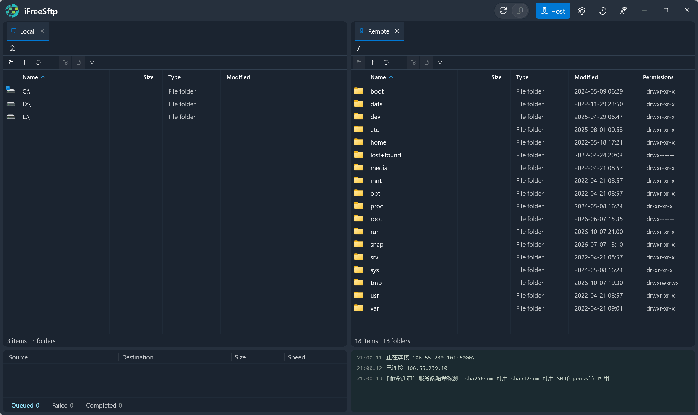
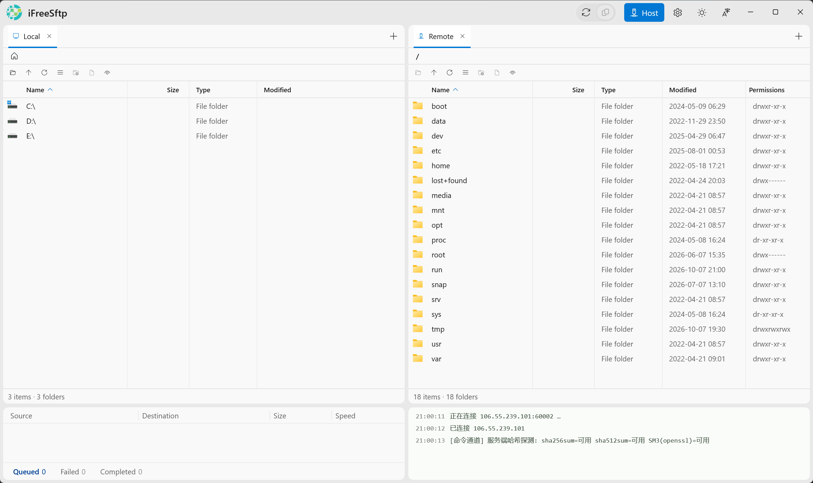
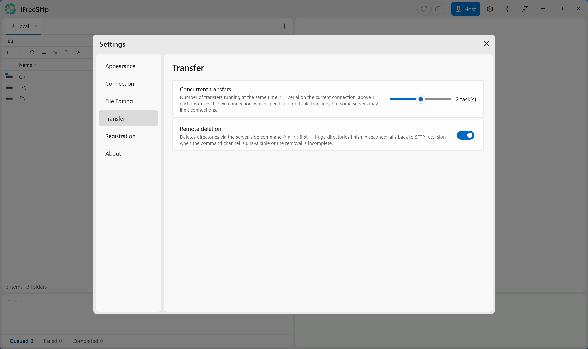

# iFreeSftp

English | [简体中文](README.zh-CN.md)

A dual-pane, multi-tab SFTP client for Windows — fast, secure, free forever, no unlocks, no restrictions. The supporter badge is a purely voluntary honor mark. Built with WinUI 3.

  

Website <https://ifrees.top> · Releases <https://github.com/iFreeshine/iFreeSftp/releases> · Get a registration code <https://ko-fi.com/ifrees/commissions?commissionAlias=61b90e1115>

> **License**: released under the [GNU AGPL-3.0](https://www.gnu.org/licenses/agpl-3.0.html). Building from this repository works out of the box.

---

## Why iFreeSftp

- **Dual panes, IDE-style multi-tab** — both folder windows host independent tabs (local or remote), so you can work on several hosts at once without juggling windows
- **Server-side direct transfer** — same-host remote→remote copies are executed by the server itself with a single `cp`: zero traffic through your machine, and large directory trees arrive in one shot instead of file-by-file round-trips
- **Secure by default** — host fingerprints are confirmed on first connect (SHA256) and pinned afterwards; a changed server key is rejected outright to stop man-in-the-middle attacks; credentials and registration data are stored DPAPI-encrypted
- **Built-in editor with remote edit & save-back** — download a temp copy, edit, save, auto-upload; mtime conflict detection warns you when the file changed underneath you
- **Real file-manager ergonomics** — drag & drop in all 4 directions, rubber-band multi-select, sync-browse file comparison, upload queue with per-file progress and retry
- **Server tooling on tap** — chmod grid with live fetch, SHA-256 / SHA-512 / SM3 checksums computed on the server, host command console with full session log
- **Thoughtful connection handling** — connect/operation timeouts, retry with delay, keep-alive; errors surface in the status bar and log panel instead of hanging forever
- **Self-contained single exe** — no runtime to install, dark/light themes, English & Chinese UI switchable at runtime

## How it compares

How iFreeSftp stacks up against the mainstream SFTP clients on Windows (compiled from the vendors' public documentation, October 2026 — corrections welcome via issue):

| | iFreeSftp | WinSCP | FileZilla | MobaXterm |
|---|---|---|---|---|
| License | AGPL-3.0, free | GPL, free | GPL, free | Freemium (Home edition limited, Pro paid) |
| Dual panes, independent tabs on **both** sides | ✓ | sessions tabbed, panes fixed | panes fixed, no tabs | terminal tabs + sidebar SFTP browser |
| **Server-side direct remote→remote** | ✓ same host runs one `cp` for the whole tree — zero traffic through your PC | re-transfers file-by-file through your PC | ✗ not supported | ✗ not supported |
| Remote edit with auto upload-back | ✓ | ✓ | △ prompts on save | △ via the SFTP browser |
| Sync-browse comparison of two folders | ✓ | ✓ (synchronize) | ✗ | ✗ |
| Server-side checksums (SHA-256/512, SM3) | ✓ | ✓ | ✗ | ✗ |
| Portable single exe, no install | ✓ | ✓ | △ | ✓ |

The differentiating row is server-side direct transfer: when both panes point at the same host, iFreeSftp issues a single `cp` command over its server-side command channel, so a 10,000-file tree copies at server disk speed instead of round-tripping through your machine.

## Download

Grab the latest `iFreeSftp-vX.Y.Z-win-x64.zip` from the [GitHub Releases](https://github.com/iFreeshine/iFreeSftp/releases) page or [ifrees.top](https://ifrees.top):

```
iFreeSftp.exe          # single-file app (self-contained, no runtime needed)
iFreeSftp.Core.dll     # core component (transfer & registration)
wpf\                   # WPF cluster for the built-in editor
locales\               # en-US / zh-CN dictionaries — editable for new languages
```

Unzip anywhere and run `iFreeSftp.exe`. Or build from source (below).

## Screenshots







## Build from source

Requirements: Windows 10 1809+ / Windows 11 and the [.NET 10 SDK](https://dotnet.microsoft.com/download/dotnet/10.0).

```powershell
.\build.ps1 build      # Debug build (compiles out of the box)
.\build.ps1 run        # Build and run
.\build.ps1 release    # Single-file publish -> release\win-x64\iFreeSftp.exe
.\build.ps1 clean      # Clean
```

## Repository layout

```
src/
├── iFreeSftp/                    # WinUI 3 main app
├── iFreeSftp.Core.Abstractions/  # Core module contract
├── iFreeSftp.Core.Stub/          # Core module implementation
└── iFreeSftp.WpfEditor/          # Built-in editor (WPF AvalonEdit)
tools/
└── export-locales.ps1            # resw -> locale JSON dictionaries (publish pipeline)
docs/screenshots/                 # Screenshots
build.ps1 / build.cmd             # Build scripts
```

## Features

| Module | Highlights |
|---|---|
| Main window | **Dual panes + multi-tab**: each side hosts independent tabs (IDE-style tab strip); per-tab local browsing or remote connection; upload queue, host command/log panel |
| Connection | Real SSH.NET connections, password or private-key auth, keep-alive |
| Host manager | Host cards: add/edit/duplicate/delete, drag to reorder, context menu, click to connect, active highlight |
| Connection security | First-connect host-fingerprint (SHA256) confirmation, remembered afterwards; changed server key is rejected outright (MITM protection) |
| Timeouts & retries | Connect timeout, per-operation timeout (errors surfaced in status bar and log panel), max retries, retry delay, keep-alive interval |
| Tab open behavior | Ask whether to open a host in the current tab or a new tab (with "always" option); connection is established first, tabs only move on success |
| Transfer | 4-direction drag & drop and context-menu transfer; same-host remote→remote copies run server-side with automatic fallback; directory transfers expand per-file into the queue with independent progress/failure tracking; transfer queue with waiting/failed tabs and full re-run |
| Settings | Categories (appearance/connection/editor/transfer/registration), live-apply, persisted as JSON under `%LOCALAPPDATA%\iFreeSftp\` |
| Supporter badge | Registration-code activation (offline ECDsa P-256 verification, DPAPI-protected storage), gold "Supporter" badge, remote announcements; registration never changes functionality |
| Localization | Chinese / English runtime switching (MRT Core + resw) |
| Themes | Dark / light, follows Windows theme on first run |
| File editing | Built-in editor (WPF AvalonEdit): content-sniffed "Edit" menu (first 8 KB probe, not extension lists), syntax highlighting, line numbers, find, undo, encoding-preserving save; external editor supported |
| Remote editing | Download temp copy + auto upload on save; mtime conflict detection with confirm dialog; per-host temp cleanup |
| Context menus | Full local menu (transfer to other side in 4 directions, edit, rename, delete, new folder/file, refresh); remote menu adds chmod grid with live fetch, SHA-256/SHA-512/SM3 checksums |
| File comparison | Sync-browse gated; aligns both lists by name, highlights one-side-only (Caution) and differing size/mtime rows (Critical) |
| Rubber-band select | Drag-select multiple entries in both lists, Ctrl to add |
| Misc | Live log with loading indicator, window size memory, ESC/mask to close panels, real system file icons (Vanara SHGetFileInfo) |

## Architecture

Desktop app, no server backend; "front end / back end" maps to the UI/service layers:

- **UI layer**: WinUI 3 / Windows App SDK — `Views/` (Header, MainContainer, FileView, HostPanel, SettingsPanel, TerminalContainer), `Controls/`
- **Built-in editor**: standalone WPF class library (`UseWPF` + AvalonEdit 6.3); hosted in its own STA thread since WinUI 3 windows cannot embed WPF content
- **Service layer**: static service classes (no DI, singleton semantics) + `Models/` (HostProfile) + JSON persistence
- **Runtime**: .NET 10 (`net10.0-windows10.0.26100.0`), unpackaged self-contained publish (single exe)
- **SSH**: SSH.NET `2026.0.0` (package id `SSH.NET`; PuTTY `.ppk` keys not supported)
- **Core module**: `iFreeSftp.Core.Abstractions` defines the module contract; `iFreeSftp.Core.Stub` is the default implementation; the release additionally ships `iFreeSftp.Core.dll`

## Registration / supporter badge

Settings → Registration: offline-verified registration code, gold "Supporter" badge, remote announcements. **Registration never changes functionality** — the badge is pure honor. Verification runs inside the core module, fully offline (ECDsa P-256).

## Sponsor

If iFreeSftp saves you time, a small sponsorship keeps development going — and comes with a gold **Supporter** badge in the app:

- International: [Ko-fi Commissions](https://ko-fi.com/ifrees/commissions?commissionAlias=61b90e1115) — order a registration code directly
- 中国大陆：[爱发电 · registration code item](https://afdian.com/item/3a69f926c4ac11f1878052540025c377) (WeChat / Alipay; full details may require sign-in)

After sponsoring, open a request on Ko-fi Commissions or 爱发电 with the name you want on the badge; the author sends back a signed registration code (see Settings → Registration).

## License

[GNU AGPL-3.0](LICENSE) — Copyright © 2026 [ifrees.top](https://ifrees.top)
